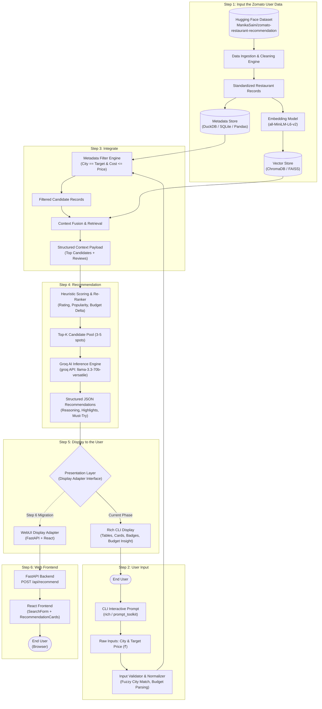
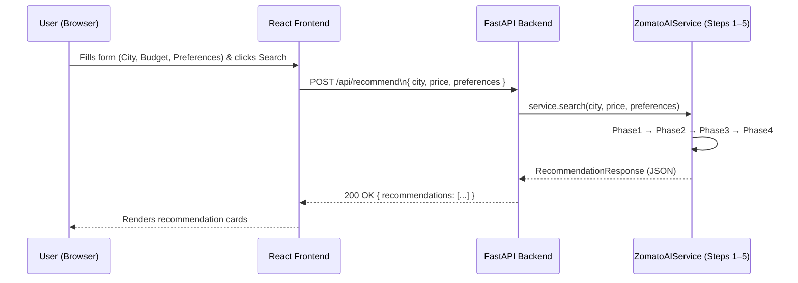
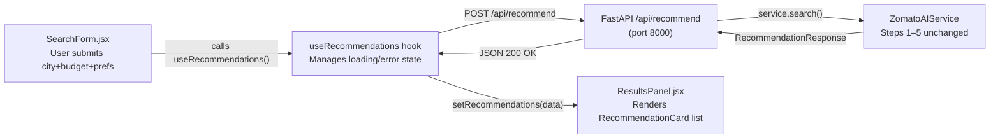

# Zomato AI Restaurant Recommendation Service — Architecture Document

## 1. Executive Summary

The **Zomato AI Restaurant Recommendation Service** is an intelligent, retrieval-augmented recommendation engine designed to suggest the best dining options based on user-specified **City** and **Price (Budget)**. 

The service ingests the [ManikaSaini/zomato-restaurant-recommendation](https://huggingface.co/datasets/ManikaSaini/zomato-restaurant-recommendation) dataset, processes and indexes restaurant metadata, enforces budget and geographic constraints, and leverages high-speed **Groq LLM inference** (`llama-3.3-70b-versatile` / `llama-3.1-8b-instant`) to provide contextual recommendations with human-like justifications.

Initial development targets an interactive **Command Line Interface (CLI)** with a decoupled presentation adapter to allow seamless migration to a **WebUI** in later iterations.

> **Constraint Compliance**: This architecture exclusively covers the 5 development phases. No deployment, cloud hosting, or container orchestration steps are included.

---

## 2. System Architecture Diagram



---

## 3. Phase-Wise 5-Step Architecture

### Step 1 – Input the Zomato User Data (Data Ingestion & Indexing)

The goal of this phase is to fetch the raw Zomato dataset, clean and normalize inconsistent fields, and build a dual-layer storage system (Metadata Store + Vector Store).

#### 1. Dataset Characteristics (`ManikaSaini/zomato-restaurant-recommendation`)
The dataset includes restaurant attributes such as:
* `name` / `restaurant name`: Name of the restaurant.
* `rate` / `aggregate rating`: Rating out of 5 (often stored as strings like `'4.1/5'`, `'NEW'`, `'-'`).
* `approx_cost(for two people)`: Financial estimate (strings with commas like `'1,200'`).
* `location` / `city`: Area and city within Bangalore.
* `cuisines`: Comma-separated cuisine types (e.g., `'North Indian, Chinese, Fast Food'`).
* `rest_type`: Type of dining (e.g., `'Casual Dining, Cafe, Quick Bites'`).
* `votes`: Number of customer reviews.
* `reviews_list`: Textual customer feedback and ratings.

#### 2. Cleaning & Transformation Pipeline
* **Rating Normalization**: Extract numerical rating, convert to `float32`. Replace `'NEW'`, `'-'`, or nulls with dataset median.
* **Cost Normalization**: Strip currency symbols and commas (`'1,200'` $\rightarrow$ `1200`), convert to integer.
* **Location Mapping**: Standardize strings to lower-case, strip trailing spaces, and index distinct localities.
* **Semantic Document Synthesis**: Combine restaurant attributes into a rich text document for embedding:
  ```
  Restaurant: {name}
  Location: {location}, {city}
  Cuisines: {cuisines}
  Type: {rest_type}
  Cost for Two: ₹{approx_cost}
  Rating: {rate} ({votes} reviews)
  Highlights: {extracted_review_snippets}
  ```

#### 3. Dual Storage Architecture
* **Relational / Metadata Store (DuckDB / SQLite / In-Memory Pandas)**: Enables sub-millisecond structured SQL queries for hard constraints (`city` and `price`).
* **Vector Store (ChromaDB / FAISS)**: Stores embeddings of the semantic document for natural language retrieval and cuisine/vibe similarity matching.

---

### Step 2 – User Input (CLI Interface & Input Validation)

This phase captures user preferences through a CLI and standardizes them into structured search criteria.

#### 1. CLI Input Prompts
* **City Prompt**: Asks user for their target city/locality (e.g., `"Koramangala"`, `"Indiranagar"`, `"Bangalore"`).
* **Price / Budget Prompt**: Asks for maximum budget for two people in INR (e.g., `800`, `"under 1000"`, `"1200"`).
* **Optional Context Prompt**: Allows optional food/vibe preference (e.g., `"biryani"`, `"romantic dinner"`, `"vegetarian"`).

#### 2. Parsing & Normalization Engine
* **Fuzzy City Resolution**: Uses string distance algorithms (e.g., Levenshtein distance via `thefuzz`) to resolve typos and alternative spellings against the known dataset localities:
  * Input: `"koramangla"` $\rightarrow$ Matched: `"Koramangala"`.
* **Budget Parser**:
  * Extracts numeric integers from string inputs (e.g., `"Under 700"` $\rightarrow$ `max_cost = 700`).
  * Applies an optional configurable tolerance window (e.g., $+10\%$ budget flex) to ensure borderline restaurants aren't abruptly missed.

#### 3. Modularity & Decoupling
Input logic is abstracted inside an `InputHandler` class. The CLI prompt delegates to this handler, ensuring the exact same validation engine can be bound to a REST API or Web form later without modification.

---

### Step 3 – Integrate (Candidate Filtering & Context Fusion)

This phase connects user criteria from **Step 2** to the knowledge base from **Step 1** to produce a filtered, context-rich candidate pool.

#### 1. Deterministic Hard-Constraint Filtering
Applies metadata filtering against the structured store:
$$\text{Filter: } \text{Lower}(\text{location}) = \text{Lower}(\text{user\_city}) \quad \land \quad \text{approx\_cost} \le \text{user\_budget}$$

If too few results are found in an exact locality, the filter automatically expands to neighboring areas within the city.

#### 2. Hybrid Retrieval & Semantic Context Fetching
* If the user provided optional taste or ambience preferences, semantic vector search is executed within the pre-filtered IDs.
* Top candidates are enriched with their textual review highlights, cuisine tags, and dining types.

#### 3. RAG Context Assembly
The top 10–15 candidate records are formatted into a compact, token-efficient JSON context payload for the Groq LLM:
```json
[
  {
    "id": 1042,
    "name": "Meghana Foods",
    "locality": "Koramangala 5th Block",
    "cost_for_two": 600,
    "rating": 4.4,
    "votes": 3400,
    "cuisines": ["Biryani", "Andhra", "South Indian"],
    "highlights": "Generous portions, spicy authentic biryani, quick service"
  }
]
```

---

### Step 4 – Recommendation (Groq LLM Reasoning & Scoring)

This phase evaluates candidate restaurants and generates personalized, grounded recommendations using **Groq**'s ultra-low latency inference API.

#### 1. Composite Scoring & Pre-Ranking
Before passing candidates to the LLM, compute an initial composite rank to select the top 3–5 finalists:
$$\text{Rank Score} = (0.45 \times \text{NormalizedRating}) + (0.25 \times \log_{10}(\text{Votes})) + \left(0.30 \times \left(1 - \frac{\text{approx\_cost}}{\text{user\_budget}}\right)\right)$$
* Balances high customer satisfaction, credible volume of reviews, and optimal budget utilization.

#### 2. Groq LLM Inference Engine
* **Model**: `llama-3.3-70b-versatile` (or `llama-3.1-8b-instant` for ultra-low latency).
* **Provider**: Groq Cloud SDK (`groq.Groq`).
* **Why Groq?**: Inference speeds exceeding 250–400 tokens/sec provide near-instantaneous CLI responses, avoiding conversational delays.

#### 3. Prompt Engineering & Output Enforcement
The Groq model is prompted with system instructions to act as a seasoned food critic and concierge, returning strictly valid JSON matching a defined schema:
```text
System: You are Zomato's AI Food Concierge.
Task: Given the user constraints (City: {city}, Budget: ₹{budget} for two) and the candidate restaurants, recommend the top 3 options.
Rules:
1. Strict adherence to budget: Every recommendation must be <= user budget.
2. Provide a 2-sentence rationale for each recommendation highlighting value-for-money and quality.
3. Name 2-3 must-try dishes based on cuisine and review highlights.
4. Output strict JSON only.
```

---

### Step 5 – Display to the User (CLI Presentation & WebUI Extensibility)

This phase presents the recommendations to the user in a visually engaging format and provides a clear architectural path toward a WebUI.

#### 1. CLI Presentation Engine (Current Development)
Built using Python's `rich` library:
* **Query Summary Card**: Displays recognized city, budget ceiling, and candidate pool size.
* **Recommendation Cards**:
  * **Header**: Restaurant Name, Star Rating (e.g., `★ 4.4 / 5.0`), Total Votes.
  * **Price Pill**: Formatted cost (`₹600 for two`) alongside budget savings (`₹200 below budget`).
  * **Cuisine & Locality**: Visual tags for quick scanning.
  * **AI Concierge Rationale**: The Groq-generated explanation rendered in a distinct color block.
  * **Must-Try Picks**: Curated dish bullet points.
* **Interactive Next Actions**: Prompts user in CLI:
  * `[1]` Refine budget or location
  * `[2]` Get alternative recommendations
  * `[3]` Exit

#### 2. Extensible Display Adapter Architecture (CLI $\rightarrow$ WebUI)
To ensure the service can transition from CLI to WebUI without rewriting business logic, the system adheres to the **Display Adapter Pattern**:

```
        +-----------------------------------------+
        |        RecommendationService            |
        |  (Step 1 -> Step 2 -> Step 3 -> Step 4) |
        +-----------------------------------------+
                             |
                     Returns Schema:
                 RecommendationResponse
                             |
              +--------------+--------------+
              |                             |
     [Current Development]         [Future Milestone]
              |                             |
              v                             v
     +-----------------+           +-----------------+
     |  CLIDisplay     |           |  WebUIDisplay   |
     |  (Rich / CLI)   |           | (Streamlit / UI)|
     +-----------------+           +-----------------+
```

When upgrading to a WebUI (e.g., Streamlit, Gradio, or FastAPI + React), only the `WebUIDisplay` component is added; Steps 1 through 4 remain completely untouched.

---

---

### Step 6 – Web Frontend (User Interface & Frontend–Backend Communication)

This phase replaces the CLI with a browser-based frontend where users can submit queries through a form and see styled recommendation cards — without changing any of the Steps 1–5 logic.

---

#### 1. Technology Choices

| Layer | Technology | Reason |
|:---|:---|:---|
| **Backend API** | **FastAPI** | Async, auto-generates OpenAPI docs, integrates directly with existing Python code (Steps 1–5) |
| **Frontend** | **React + Tailwind CSS** | Component-driven UI, responsive design, works well with JSON APIs |
| **Communication** | **REST over HTTP (JSON)** | Simple, stateless, debuggable in browser DevTools |
| **State Management** | **React `useState` / `useEffect`** | Lightweight — no Redux needed for this single-page form |

---

#### 2. System Communication Flow



---

#### 3. API Contract

##### `POST /api/recommend`
Single endpoint — the frontend sends this JSON body and receives structured recommendations.

**Request Body**
```json
{
  "city": "koramangala",
  "price": "under 800",
  "preferences": "Biryani"
}
```

**Response Body (200 OK)**
```json
{
  "query": {
    "city": "Koramangala",
    "budget": 800,
    "preferences": "Biryani"
  },
  "recommendations": [
    {
      "rank": 1,
      "restaurant_name": "Meghana Foods",
      "location": "Koramangala 1st Block",
      "rating": 4.4,
      "votes": 4100,
      "cost_for_two": 600,
      "cuisines": "Biryani, Andhra, South Indian",
      "rest_type": "Casual Dining",
      "online_order": "Yes",
      "book_table": "No",
      "ai_rationale": "Meghana Foods is a Koramangala institution known for its fiery Andhra-style Biryani...",
      "must_try_dishes": ["Chicken Boneless Biryani", "Chilli Chicken", "Paneer Biryani"],
      "budget_saving": 200,
      "score": 0.87
    }
  ],
  "model_name": "openai/gpt-oss-120b",
  "latency_ms": 1340,
  "candidate_count": 12
}
```

**Error Responses**
| Status | Condition |
|:---|:---|
| `422 Unprocessable Entity` | Missing or invalid `city` / `price` fields |
| `404 Not Found` | No restaurants found for the given city+budget combination |
| `503 Service Unavailable` | Groq API unreachable or rate-limited |

---

#### 4. Backend FastAPI Structure

```text
phase6/
├── __init__.py
├── api.py                  # FastAPI app, route definitions
├── schemas.py              # Pydantic request/response models for the API
├── server.py               # Uvicorn server launcher
└── tests/
    ├── __init__.py
    └── test_phase6.py      # API integration tests (TestClient)
```

**`api.py` — Key Routes**
```python
from fastapi import FastAPI
from fastapi.middleware.cors import CORSMiddleware
from phase6.schemas import RecommendRequest, RecommendResponse

app = FastAPI(title="Zomato AI Recommendation API")

# Allow React dev server (localhost:3000) to call the API
app.add_middleware(CORSMiddleware, allow_origins=["http://localhost:3000"], allow_methods=["*"])

@app.post("/api/recommend", response_model=RecommendResponse)
async def recommend(req: RecommendRequest):
    # Delegates directly to ZomatoAIService (Steps 1–5, unchanged)
    ...

@app.get("/api/cities")
async def list_cities():
    # Returns list of available Bangalore localities from MetadataStore
    ...

@app.get("/health")
async def health():
    return {"status": "ok"}
```

---

#### 5. Frontend React Structure

```text
phase6/
└── frontend/
    ├── public/
    │   └── index.html
    ├── src/
    │   ├── App.jsx                 # Root component, layout
    │   ├── components/
    │   │   ├── SearchForm.jsx      # City dropdown, budget input, preferences text field
    │   │   ├── RecommendationCard.jsx  # Individual restaurant card
    │   │   ├── ResultsPanel.jsx    # Maps over recommendations, renders cards
    │   │   └── LoadingSpinner.jsx  # Shown while API call is in-flight
    │   ├── hooks/
    │   │   └── useRecommendations.js   # Custom hook: manages fetch state, loading, error
    │   ├── api/
    │   │   └── client.js           # Axios/fetch wrapper for POST /api/recommend
    │   └── index.jsx
    ├── package.json
    └── tailwind.config.js
```

---

#### 6. Frontend–Backend Communication Detail



**CORS Setup**: The FastAPI backend allows `http://localhost:3000` (React dev) and the production domain during deployment.

**Loading States**:
- `idle` → User hasn't searched yet, show welcome banner
- `loading` → API call in-flight, show spinner + "Finding restaurants…"
- `success` → Recommendations received, render cards
- `error` → API failed, show error message with retry button

---

#### 7. Key UI Components

**SearchForm** — Input panel (top of page):
- 🏙 **City dropdown** — pre-populated from `GET /api/cities` on page load
- 💰 **Budget input** — number field or preset chips (`< ₹500`, `₹500–₹1000`, `> ₹1000`)
- 🍽 **Preferences text field** — optional free-text (e.g., "Biryani, Vegetarian")
- 🔍 **Search button** — triggers `POST /api/recommend`

**RecommendationCard** — One card per restaurant:
- Restaurant name + Star rating badge (color-coded: 🟢 ≥4.0, 🟡 3.5–3.9, 🔴 <3.5)
- Cost for two + budget savings chip (e.g., `₹200 below budget`)
- Cuisine tags + locality label
- AI Rationale block (Groq-generated, expandable)
- Must-Try Dishes list
- Online Order / Table Booking badges

---

#### 8. Development Startup Commands

```bash
# Terminal 1 — Start FastAPI backend (port 8000)
uvicorn phase6.api:app --reload --port 8000

# Terminal 2 — Start React frontend (port 3000)
cd phase6/frontend
npm install
npm start
```

The app is then accessible at **`http://localhost:3000`**, which proxies API calls to **`http://localhost:8000`**.

---

## 4. Technical Stack Summary

| Step | Layer | Technologies / Libraries |
| :--- | :--- | :--- |
| **Step 1** | Data Ingestion & Storage | `datasets` (Hugging Face), `pandas`, `duckdb`, `chromadb`, `sentence-transformers` |
| **Step 2** | User Input & Parsing | `prompt_toolkit`, `thefuzz`, `pydantic` |
| **Step 3** | Integration & Retrieval | `duckdb` (SQL filter), `numpy`, `chromadb` |
| **Step 4** | AI Recommendation Engine | `groq` SDK (`llama-3.3-70b-versatile` / `llama-3.1-8b-instant`), `pydantic` |
| **Step 5** | Display & UI | `rich` (current CLI), `streamlit` / `fastapi` (future WebUI target) |
| **Step 6** | Web Frontend & API | `fastapi`, `uvicorn`, `pydantic` (backend); `react`, `tailwind css`, `axios` (frontend) |

---

## 5. Directory & Module Structure

```text
RAG-Zepto/
│
├── Architecture.md                 # System architecture documentation
├── pyproject.toml / requirements.txt# Project dependencies
│
├── src/
│   ├── __init__.py
│   │
│   ├── step1_data/                 # Step 1: Ingestion & Knowledge Base
│   │   ├── ingest.py               # Hugging Face dataset loader
│   │   ├── clean.py                # Data cleaning & normalization
│   │   └── indexer.py              # Metadata store & Vector DB builder
│   │
│   ├── step2_input/                # Step 2: Input Capture & Validation
│   │   ├── parser.py               # Fuzzy city matching & budget parser
│   │   └── models.py               # Input Pydantic schemas (CityQuery)
│   │
│   ├── step3_integrate/            # Step 3: Retrieval & Context Fusion
│   │   ├── filter.py               # SQL/Metadata filter (City & Cost)
│   │   └── retriever.py            # Candidate pool aggregation
│   │
│   ├── step4_recommendation/       # Step 4: Groq AI Recommendation
│   │   ├── scorer.py               # Composite ranking algorithm
│   │   ├── groq_client.py          # Groq API client & prompt manager
│   │   └── schemas.py              # Recommendation output schema
│   │
│   └── step5_display/              # Step 5: Presentation Layer
│       ├── base.py                 # Abstract Base Display Adapter
│       ├── cli_display.py          # Rich CLI implementation (Active)
│       └── web_display.py          # Future WebUI implementation placeholder
│
└── main.py                         # CLI entrypoint connecting Steps 1–5
```

